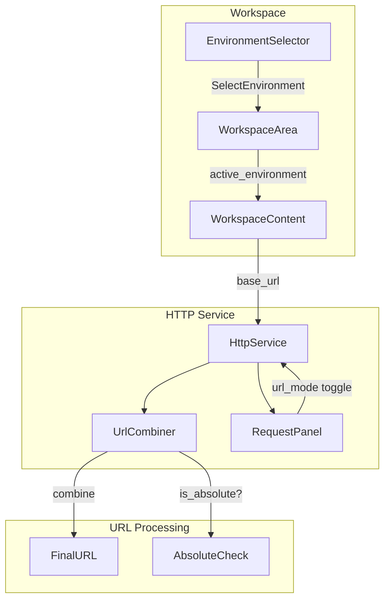

# Design Document: Environment Base URL Integration

## Overview

本设计实现环境管理中的 base_url 与 HTTP 服务请求的集成。核心思路是：
1. 通过事件机制将当前环境的 base_url 传递给 HTTP 服务组件
2. 在 HTTP 服务中添加 URL 模式开关，让用户选择是否使用 base_url
3. 实现智能的 URL 组合逻辑，正确处理各种边界情况

## Architecture



数据流：
1. `EnvironmentSelector` 发出 `SelectEnvironment` 事件
2. `WorkspaceArea` 处理事件，更新 `active_environment_id`
3. `WorkspaceContent` 将当前环境的 `base_url` 传递给 `HttpService`
4. `HttpService` 根据 URL 模式决定是否使用 base_url

## Components and Interfaces

### 1. HttpService 组件更新

```rust
pub struct HttpService {
    // 现有字段...
    url: Entity<InputState>,
    
    // 新增字段
    base_url: String,           // 从环境获取的 base_url
    use_base_url: bool,         // URL 模式开关
}

impl HttpService {
    /// 创建 HttpService，接收可选的 base_url
    pub fn new(
        config: HttpConfig, 
        base_url: Option<String>,
        window: &mut Window, 
        cx: &mut Context<Self>
    ) -> Self;
    
    /// 更新 base_url（当环境切换时调用）
    pub fn set_base_url(&mut self, base_url: String, cx: &mut Context<Self>);
    
    /// 切换 URL 模式
    pub fn toggle_use_base_url(&mut self, cx: &mut Context<Self>);
    
    /// 获取最终 URL
    pub fn final_url(&self, cx: &Context<Self>) -> String;
}
```

### 2. URL 组合模块

```rust
/// URL 组合工具函数
pub mod url_utils {
    /// 判断 URL 是否为绝对 URL
    pub fn is_absolute_url(url: &str) -> bool;
    
    /// 组合 base_url 和 path
    /// - 处理 base_url 末尾斜杠
    /// - 处理 path 开头斜杠
    /// - 避免双斜杠
    pub fn combine_url(base_url: &str, path: &str) -> String;
    
    /// 根据模式计算最终 URL
    pub fn resolve_url(base_url: &str, path: &str, use_base_url: bool) -> String;
}
```

### 3. RequestPanel 更新

```rust
pub struct RequestPanel {
    // 现有字段...
    
    // 新增
    use_base_url: bool,
    base_url: String,
}

pub enum RequestPanelEvent {
    // 现有事件...
    Send,
    AddHeader,
    BodyTypeChanged(BodyType),
    MethodChanged(HttpMethod),
    
    // 新增
    ToggleBaseUrl,
}
```

## Data Models

### HttpConfig 扩展

```rust
#[derive(Debug, Clone, Serialize, Deserialize)]
pub struct HttpConfig {
    pub method: HttpMethod,
    pub path: String,
    pub parameters: Vec<Parameter>,
    pub request_body: Option<RequestBody>,
    pub responses: Vec<Response>,
    pub security: Vec<String>,
    
    // 新增：URL 模式偏好
    #[serde(default = "default_use_base_url")]
    pub use_base_url: bool,
}

fn default_use_base_url() -> bool {
    true  // 默认启用 base_url
}
```

## Correctness Properties

*A property is a characteristic or behavior that should hold true across all valid executions of a system—essentially, a formal statement about what the system should do. Properties serve as the bridge between human-readable specifications and machine-verifiable correctness guarantees.*

### Property 1: URL Combination Correctness

*For any* base_url and path combination:
- If path is an absolute URL (starts with `http://` or `https://`), the result should equal the path
- If path is relative and base_url is non-empty, the result should be `base_url + "/" + path` with exactly one slash between them
- If base_url is empty, the result should equal the path

**Validates: Requirements 3.1, 3.2, 3.3, 3.4**

### Property 2: URL Mode Disabled Bypass

*For any* user-entered URL, when URL mode is disabled, the final URL should exactly equal the user-entered URL, regardless of the base_url value.

**Validates: Requirements 2.3**

### Property 3: URL Mode Persistence Round-Trip

*For any* HttpConfig with a use_base_url setting, serializing then deserializing should preserve the use_base_url value.

**Validates: Requirements 2.4**

### Property 4: Request Info URL Accuracy

*For any* HTTP request sent, the URL recorded in the request info should exactly match the URL that was actually used for the request.

**Validates: Requirements 5.1**

## Error Handling

| 场景 | 处理方式 |
|------|----------|
| base_url 为空且模式启用 | 直接使用用户输入的 URL |
| 用户输入为空 | 如果 base_url 存在，使用 base_url；否则显示错误 |
| URL 格式无效 | 在发送请求时由 reqwest 库处理，显示错误信息 |
| 环境切换时 HttpService 不存在 | 忽略，下次创建时会获取正确的 base_url |

## Testing Strategy

### Unit Tests

1. **URL 组合函数测试**
   - 测试 `is_absolute_url` 函数的各种输入
   - 测试 `combine_url` 函数的边界情况
   - 测试 `resolve_url` 函数的模式切换

2. **HttpConfig 序列化测试**
   - 测试 `use_base_url` 字段的序列化/反序列化
   - 测试默认值行为

### Property-Based Tests

使用 `proptest` 库进行属性测试，每个属性测试运行至少 100 次迭代。

1. **Property 1 测试**: 生成随机的 base_url 和 path 组合，验证 URL 组合逻辑
2. **Property 2 测试**: 生成随机 URL，验证禁用模式时的行为
3. **Property 3 测试**: 生成随机 HttpConfig，验证序列化往返
4. **Property 4 测试**: 集成测试，验证请求信息记录

### Test Configuration

```toml
[dev-dependencies]
proptest = "1.4"
```

测试标注格式：
```rust
// Feature: environment-base-url-integration, Property 1: URL Combination Correctness
#[test]
fn prop_url_combination_correctness() { ... }
```
