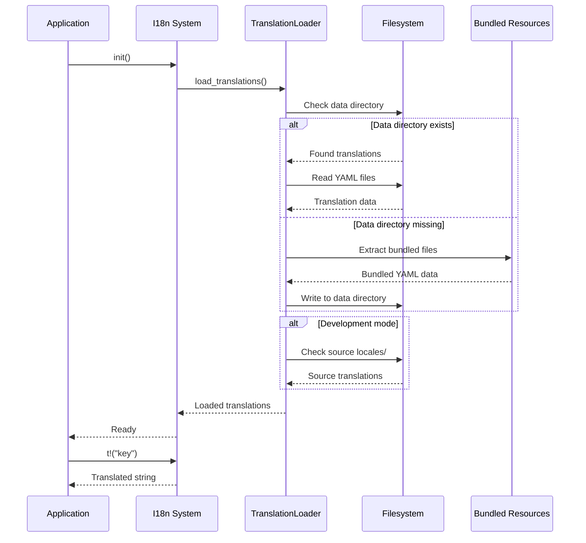

# Design Document: Runtime I18n Loading System

## Overview

This design specifies a runtime translation loading system to replace the current compile-time embedded approach. The new system will load YAML translation files from the filesystem at application startup, enabling post-distribution extensibility while maintaining backward compatibility with the existing `t!()` macro API.

The design addresses three key scenarios:
1. **Production**: Load translations from the application's data directory
2. **Development**: Fall back to source repository `locales/` directory
3. **First Run**: Extract bundled translations to the data directory

The implementation will use a custom translation backend that replaces rust-i18n's compile-time macro with runtime file loading, while preserving the same public API for minimal code changes.

## Architecture

### High-Level Architecture

```
┌─────────────────────────────────────────────────────────────┐
│                     Application Layer                        │
│  (Uses t!() macro and set_locale() - no changes needed)     │
└───────────────────────┬─────────────────────────────────────┘
                        │
┌───────────────────────▼─────────────────────────────────────┐
│                  I18n Runtime System                         │
│  ┌──────────────────────────────────────────────────────┐   │
│  │  TranslationLoader                                   │   │
│  │  - Load from data directory                          │   │
│  │  - Fall back to source directory                     │   │
│  │  - Extract bundled resources                         │   │
│  └──────────────────────────────────────────────────────┘   │
│  ┌──────────────────────────────────────────────────────┐   │
│  │  TranslationStore                                    │   │
│  │  - HashMap<Locale, HashMap<Key, Value>>              │   │
│  │  - Current locale state                              │   │
│  │  - Key resolution with fallback                      │   │
│  └──────────────────────────────────────────────────────┘   │
└───────────────────────┬─────────────────────────────────────┘
                        │
┌───────────────────────▼─────────────────────────────────────┐
│                   Filesystem Layer                           │
│  ┌────────────────────┐  ┌────────────────────────────┐     │
│  │  Data Directory    │  │  Bundled Resources         │     │
│  │  ~/Library/...     │  │  (embedded in binary)      │     │
│  │  - en.yml          │  │  - en.yml                  │     │
│  │  - zh-CN.yml       │  │  - zh-CN.yml               │     │
│  └────────────────────┘  └────────────────────────────┘     │
└─────────────────────────────────────────────────────────────┘
```

### Component Interaction Flow



## Components and Interfaces

### 1. TranslationLoader

**Responsibility**: Load translation files from various sources with fallback logic.

**Interface**:
```rust
pub struct TranslationLoader {
    data_dir: PathBuf,
    source_dir: Option<PathBuf>,
}

impl TranslationLoader {
    /// Create a new loader with data directory and optional source directory
    pub fn new(data_dir: PathBuf, source_dir: Option<PathBuf>) -> Self;
    
    /// Load all available translation files
    /// Returns: HashMap<Locale, HashMap<Key, Value>>
    pub fn load_all(&self) -> Result<HashMap<String, HashMap<String, String>>>;
    
    /// Load a specific locale
    pub fn load_locale(&self, locale: &str) -> Result<HashMap<String, String>>;
    
    /// Extract bundled translations to data directory
    pub fn extract_bundled_translations(&self) -> Result<()>;
    
    /// Check if data directory has translations
    pub fn has_translations(&self) -> bool;
}
```

**Implementation Details**:
- Search order: data directory → source directory (dev mode only)
- File naming: `{locale}.yml` (e.g., `en.yml`, `zh-CN.yml`)
- YAML parsing using `serde_yaml`
- Flatten nested YAML structure into dot-notation keys (e.g., `common.save` → "common.save")
- Log all file operations for debugging

### 2. TranslationStore

**Responsibility**: Store loaded translations and provide key lookup with fallback.

**Interface**:
```rust
pub struct TranslationStore {
    translations: RwLock<HashMap<String, HashMap<String, String>>>,
    current_locale: RwLock<String>,
    default_locale: String,
}

impl TranslationStore {
    /// Create a new store with translations
    pub fn new(
        translations: HashMap<String, HashMap<String, String>>,
        default_locale: String,
    ) -> Self;
    
    /// Get translation for key in current locale
    pub fn get(&self, key: &str) -> Option<String>;
    
    /// Get translation for key in specific locale
    pub fn get_locale(&self, locale: &str, key: &str) -> Option<String>;
    
    /// Set current locale
    pub fn set_locale(&self, locale: &str);
    
    /// Get current locale
    pub fn current_locale(&self) -> String;
    
    /// Get all available locales
    pub fn available_locales(&self) -> Vec<String>;
}
```

**Implementation Details**:
- Thread-safe using `RwLock` for concurrent access
- Fallback chain: current locale → default locale (en) → return key
- Support for parameterized translations (e.g., `"Created %{at}"`)

### 3. RuntimeBackend (rust-i18n Backend Implementation)

**Responsibility**: Implement rust-i18n's `Backend` trait to integrate with existing macro system.

**Interface**:
```rust
pub struct RuntimeBackend {
    store: Arc<TranslationStore>,
}

impl Backend for RuntimeBackend {
    fn available_locales(&self) -> Vec<&str>;
    fn translate(&self, locale: &str, key: &str) -> Option<&str>;
}
```

**Implementation Details**:
- Wraps `TranslationStore` with Arc for shared ownership
- Implements rust-i18n's `Backend` trait
- Returns static string references (requires internal string caching)

### 4. Initialization Module

**Responsibility**: Initialize the i18n system at application startup.

**Interface**:
```rust
/// Initialize the i18n system with runtime loading
/// Must be called before any t!() macro usage
pub fn init() -> Result<()>;

/// Initialize with custom data directory
pub fn init_with_dir(data_dir: PathBuf) -> Result<()>;

/// Get the data directory path for translations
pub fn get_data_dir() -> PathBuf;
```

**Implementation Details**:
- Determine data directory based on platform (using `dirs` crate)
  - macOS: `~/Library/Application Support/Zeph/locales/`
  - Linux: `~/.local/share/zeph/locales/`
  - Windows: `%APPDATA%\Zeph\locales\`
- Check for bundled translations and extract if needed
- Load all translations into global store
- Register backend with rust-i18n

### 5. Bundled Resource Manager

**Responsibility**: Embed translation files in the binary and extract them at runtime.

**Interface**:
```rust
pub struct BundledTranslations;

impl BundledTranslations {
    /// Get bundled translation file content
    pub fn get(locale: &str) -> Option<&'static [u8]>;
    
    /// Get all available bundled locales
    pub fn available_locales() -> Vec<&'static str>;
    
    /// Extract all bundled translations to directory
    pub fn extract_to(dir: &Path) -> Result<()>;
}
```

**Implementation Details**:
- Use `include_bytes!()` macro to embed YAML files at compile time
- Store as static byte arrays
- Extract to filesystem on first run or when files are missing

## Data Models

### Translation File Format

Each locale has its own YAML file with nested structure:

**File: `en.yml`**
```yaml
_version: 2

common:
  save: "Save"
  cancel: "Cancel"
  loading: "Loading..."

welcome:
  title: "Welcome to ZEPH"
  description: "Your API testing companion"

folders:
  fields:
    name: "Name"
    description: "Description"
```

**File: `zh-CN.yml`**
```yaml
_version: 2

common:
  save: "保存"
  cancel: "取消"
  loading: "加载中..."

welcome:
  title: "欢迎使用 ZEPH"
  description: "您的 API 测试伴侣"

folders:
  fields:
    name: "名称"
    description: "描述"
```

### Internal Data Structure

After loading, translations are flattened into a two-level HashMap:

```rust
HashMap<Locale, HashMap<Key, Value>>

// Example:
{
    "en": {
        "common.save": "Save",
        "common.cancel": "Cancel",
        "welcome.title": "Welcome to ZEPH",
        "folders.fields.name": "Name",
    },
    "zh-CN": {
        "common.save": "保存",
        "common.cancel": "取消",
        "welcome.title": "欢迎使用 ZEPH",
        "folders.fields.name": "名称",
    }
}
```

### Configuration Metadata

Each translation file includes a `_version` field for future compatibility:

```rust
pub struct TranslationMetadata {
    pub version: u32,
}
```

## Correctness Properties

*A property is a characteristic or behavior that should hold true across all valid executions of a system—essentially, a formal statement about what the system should do. Properties serve as the bridge between human-readable specifications and machine-verifiable correctness guarantees.*

### Property 1: Translation Key Consistency

*For any* translation key that exists in the default locale (en), querying that key in any loaded locale should either return a translated string or fall back to the default locale's value.

**Validates: Requirements 5.2**

### Property 2: Locale File Independence

*For any* valid locale file, loading it should not affect the translations of other already-loaded locales.

**Validates: Requirements 2.2**

### Property 3: Data Directory Fallback

*For any* translation key, if the data directory is empty or missing, the system should successfully load translations from either bundled resources or the source directory (in development mode).

**Validates: Requirements 4.2**

### Property 4: YAML Round-Trip Consistency

*For any* valid translation file, parsing the YAML and then serializing it back should preserve all translation keys and values (structure may differ but content must match).

**Validates: Requirements 1.3**

### Property 5: Locale Switching Idempotence

*For any* locale, switching to that locale multiple times should produce the same translation results for all keys.

**Validates: Requirements 5.4**

### Property 6: Key Fallback Chain

*For any* translation key that doesn't exist in the current locale, the system should return either the default locale's translation or the key itself, never returning None or panicking.

**Validates: Requirements 5.2**

### Property 7: File Extraction Idempotence

*For any* data directory, extracting bundled translations multiple times should result in the same files with the same content.

**Validates: Requirements 3.4**

### Property 8: Concurrent Access Safety

*For any* sequence of concurrent translation lookups and locale switches, all operations should complete without data races or panics.

**Validates: Requirements 5.1, 5.4**

## Error Handling

### Error Types

```rust
#[derive(Debug, thiserror::Error)]
pub enum I18nError {
    #[error("Failed to create data directory: {0}")]
    DataDirCreation(#[from] std::io::Error),
    
    #[error("Failed to parse translation file {file}: {source}")]
    ParseError {
        file: String,
        source: serde_yaml::Error,
    },
    
    #[error("No translations could be loaded")]
    NoTranslationsAvailable,
    
    #[error("Failed to extract bundled translations: {0}")]
    BundleExtractionError(String),
    
    #[error("Locale '{0}' not found")]
    LocaleNotFound(String),
}
```

### Error Handling Strategy

1. **Initialization Errors**:
   - Log error with full context
   - Fall back to next available source (data dir → source dir → bundled)
   - If all sources fail, use keys as display text (degraded mode)

2. **Parse Errors**:
   - Log which file failed and why
   - Continue loading other locale files
   - Skip malformed entries within a file

3. **Runtime Errors**:
   - Translation lookup never panics
   - Missing keys return the key itself
   - Locale switching validates locale exists before switching

4. **File System Errors**:
   - Log I/O errors with file paths
   - Attempt alternative sources
   - Gracefully degrade to available translations

### Logging Strategy

```rust
// Initialization
tracing::info!("Initializing i18n system with data dir: {}", data_dir.display());

// Loading success
tracing::info!("Loaded {} translations from {}", count, path.display());

// Loading failure
tracing::warn!("Failed to load translations from {}: {}", path.display(), error);

// Fallback activation
tracing::info!("Falling back to source directory: {}", source_dir.display());

// Parse errors
tracing::error!("Failed to parse {}: {}", file, error);

// Missing keys (debug level)
tracing::debug!("Translation key not found: {} (locale: {})", key, locale);
```

## Testing Strategy

### Unit Tests

Unit tests will verify specific examples, edge cases, and error conditions:

1. **YAML Parsing**:
   - Valid nested YAML structures
   - Empty files
   - Malformed YAML
   - Special characters in keys and values
   - Unicode content

2. **Key Resolution**:
   - Exact key matches
   - Missing keys (fallback to default locale)
   - Missing keys in all locales (return key)
   - Nested key paths
   - Parameterized translations

3. **File Loading**:
   - Load from data directory
   - Load from source directory
   - Load from bundled resources
   - Missing files
   - Permission errors

4. **Locale Switching**:
   - Switch to available locale
   - Switch to unavailable locale
   - Get current locale
   - List available locales

### Property-Based Tests

Property-based tests will verify universal properties across all inputs using a Rust PBT library (e.g., `proptest` or `quickcheck`). Each test should run a minimum of 100 iterations.

1. **Property Test: Translation Key Consistency**
   - Generate random translation keys
   - Verify fallback chain works for all keys
   - **Feature: i18n-runtime-loading, Property 1: Translation Key Consistency**

2. **Property Test: Locale File Independence**
   - Generate random locale data
   - Load locales in different orders
   - Verify each locale's translations are unaffected
   - **Feature: i18n-runtime-loading, Property 2: Locale File Independence**

3. **Property Test: YAML Round-Trip**
   - Generate random translation structures
   - Parse → serialize → parse
   - Verify content preservation
   - **Feature: i18n-runtime-loading, Property 4: YAML Round-Trip Consistency**

4. **Property Test: Locale Switching Idempotence**
   - Generate random locale switches
   - Verify repeated switches produce same results
   - **Feature: i18n-runtime-loading, Property 5: Locale Switching Idempotence**

5. **Property Test: Key Fallback Chain**
   - Generate random keys (some missing)
   - Verify never returns None or panics
   - **Feature: i18n-runtime-loading, Property 6: Key Fallback Chain**

6. **Property Test: File Extraction Idempotence**
   - Extract bundled files multiple times
   - Verify file content remains identical
   - **Feature: i18n-runtime-loading, Property 7: File Extraction Idempotence**

7. **Property Test: Concurrent Access Safety**
   - Generate random concurrent operations
   - Verify no data races or panics
   - **Feature: i18n-runtime-loading, Property 8: Concurrent Access Safety**

### Integration Tests

Integration tests will verify the system works end-to-end:

1. **Full Initialization Flow**:
   - First run (extract bundled → load)
   - Subsequent runs (load from data dir)
   - Development mode (load from source)

2. **Application Integration**:
   - Initialize i18n before app startup
   - Use t!() macro throughout app
   - Switch locales at runtime
   - Verify UI updates

3. **File System Integration**:
   - Create/delete data directory
   - Modify translation files
   - Restart app and verify changes

### Test Configuration

- Use `proptest` for property-based testing
- Minimum 100 iterations per property test
- Tag each property test with design document reference
- Use temporary directories for file system tests
- Mock file system for error condition tests
