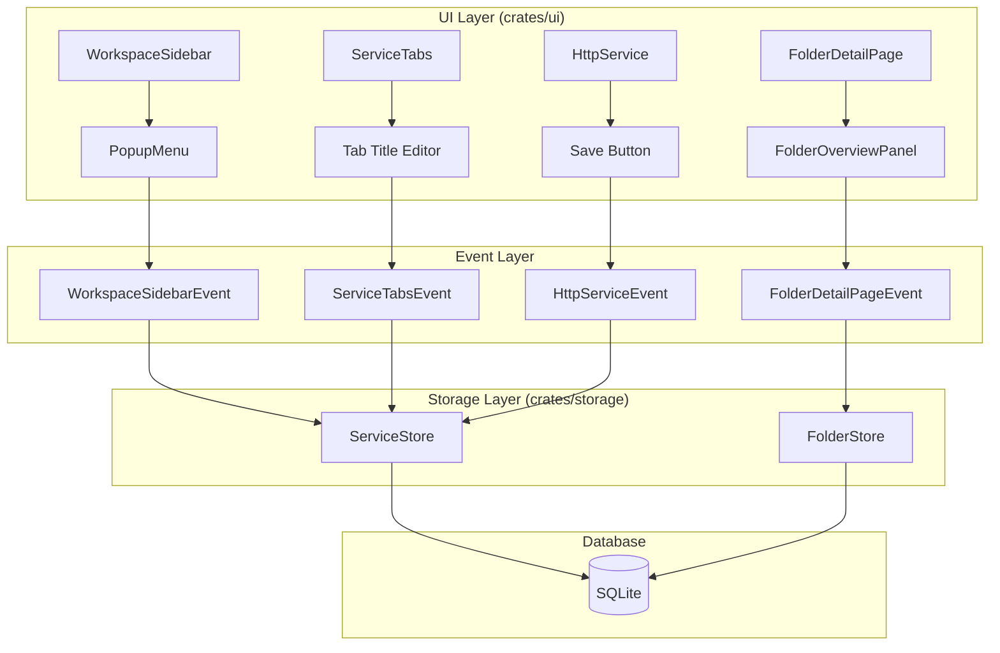
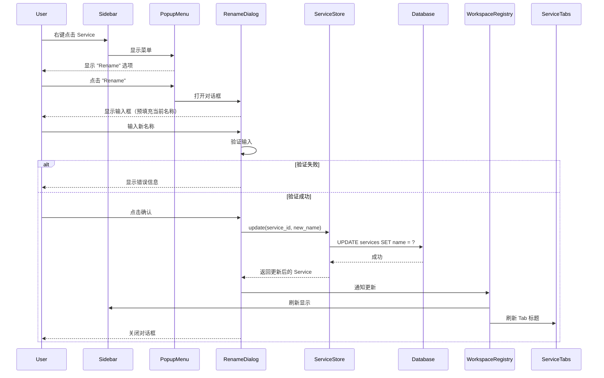
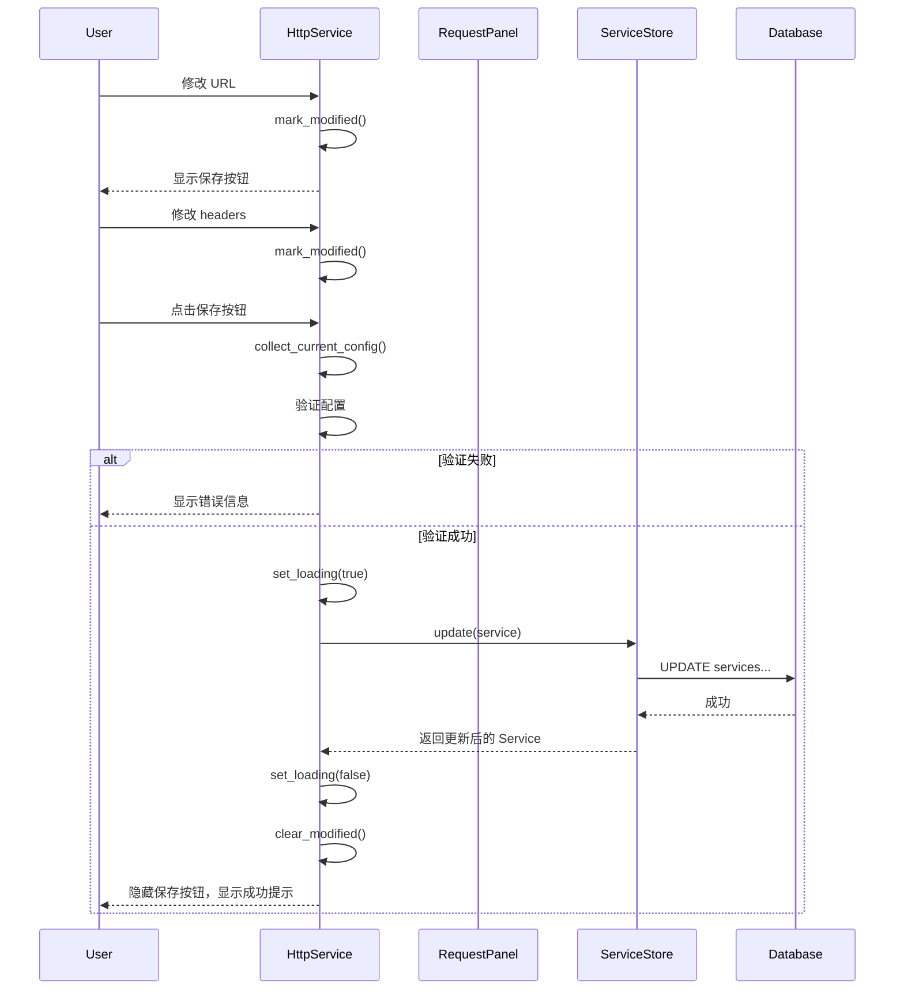
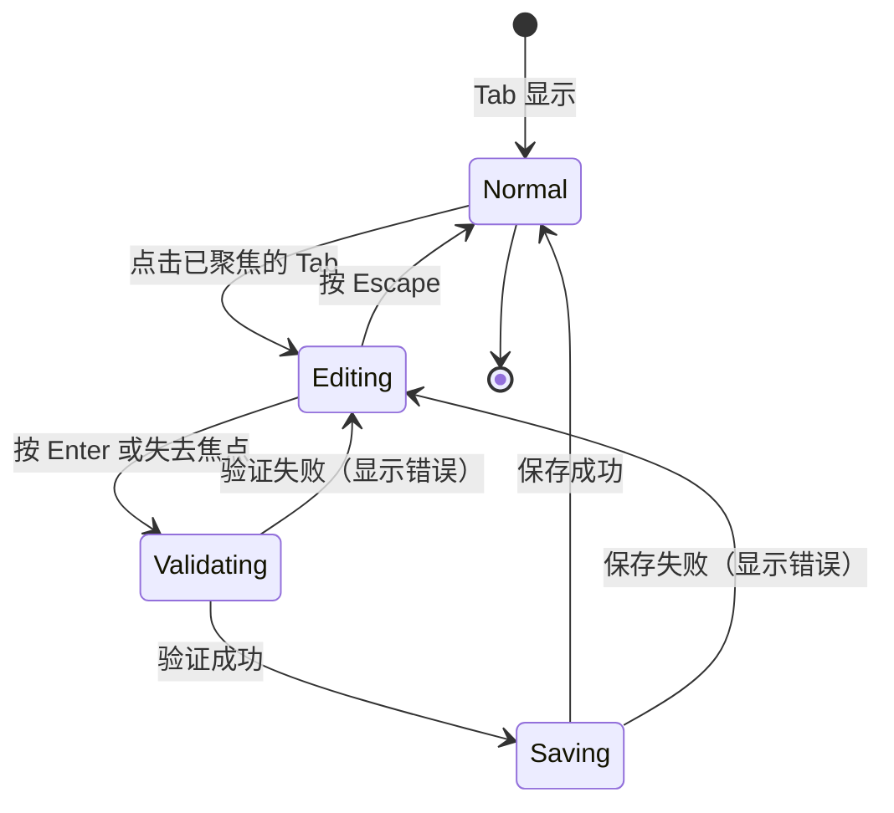

# Design Document: Service and Folder Rename and Save

## Overview

本设计文档描述了为 Zeph API 测试工具添加 Service 和 Folder 的重命名和保存修改功能的技术方案。该功能将允许用户通过多种方式（右键菜单、Tab 标题编辑、详情页面）重命名和编辑 Service 和 Folder，并将修改持久化到 SQLite 数据库。

### 设计目标

1. **多入口重命名**：支持从 Sidebar 右键菜单和 Service Tab 标题直接重命名
2. **详情页编辑**：在 Folder 详情页的 Overview 标签中编辑基本信息
3. **Service 保存**：保存 HttpService 页面的所有修改（URL、method、headers、body、query params）
4. **数据验证**：在 UI 层和存储层都进行数据验证
5. **状态同步**：确保所有 UI 组件实时反映数据变化
6. **国际化**：所有新增 UI 文本支持中英文

## Architecture

### 系统架构图



### 数据流

1. **重命名流程**：
   - 用户触发重命名（右键菜单/Tab 点击）
   - UI 显示输入框或对话框
   - 用户输入新名称
   - UI 层验证输入
   - 发送事件到存储层
   - 存储层更新数据库
   - 通过 WorkspaceRegistry 通知所有订阅者
   - UI 组件刷新显示

2. **保存流程**：
   - 用户修改 Service 配置
   - UI 标记为已修改状态
   - 用户点击保存按钮
   - 收集所有修改的数据
   - 验证数据完整性
   - 调用 ServiceStore::update
   - 更新数据库
   - 清除已修改状态

## Components and Interfaces

### 1. Rename Dialog Component

新增一个通用的重命名对话框组件：

```rust
// crates/ui/src/rename_dialog.rs

pub struct RenameDialog {
    input: Entity<InputState>,
    original_name: SharedString,
    entity_type: EntityType,
    validation_error: Option<SharedString>,
}

pub enum EntityType {
    Service,
    Folder,
}

pub enum RenameDialogEvent {
    Confirm(SharedString),
    Cancel,
}

impl RenameDialog {
    pub fn new(
        original_name: SharedString,
        entity_type: EntityType,
        window: &mut Window,
        cx: &mut Context<Self>,
    ) -> Self;
    
    fn validate_name(&self, name: &str) -> Result<(), SharedString>;
}
```

### 2. Tab Title Editor

为 ServiceTabs 添加内联编辑功能：

```rust
// crates/ui/src/service_tabs.rs

pub struct ServiceTabs {
    workspace: Option<Workspace>,
    editing_tab: Option<ContentType>,  // 新增：正在编辑的 tab
    edit_input: Option<Entity<InputState>>,  // 新增：编辑输入框
}

pub enum ServiceTabsEvent {
    Select(ContentType),
    Close(ContentType),
    Rename(ContentType, SharedString),  // 新增：重命名事件
}

impl ServiceTabs {
    fn start_editing(&mut self, content_type: ContentType, window: &mut Window, cx: &mut Context<Self>);
    fn finish_editing(&mut self, cx: &mut Context<Self>);
    fn cancel_editing(&mut self, cx: &mut Context<Self>);
}
```

### 3. FolderStore Update Method

为 FolderStore 添加通用的 update 方法：

```rust
// crates/storage/src/folder.rs

impl<'a> FolderStore<'a> {
    /// Update folder basic information
    pub fn update(
        &self,
        folder_id: Uuid,
        name: Option<&str>,
        description: Option<Option<&str>>,
        parent_id: Option<Option<Uuid>>,
    ) -> Result<Folder>;
    
    /// Validate folder name
    fn validate_name(&self, name: &str) -> Result<()>;
    
    /// Validate folder description
    fn validate_description(&self, description: &str) -> Result<()>;
}
```

### 4. HttpService Save State

为 HttpService 添加保存状态管理：

```rust
// crates/ui/src/http_service/http_service.rs

pub struct HttpService {
    // ... existing fields ...
    is_modified: bool,  // 新增：是否有未保存的修改
    original_config: HttpConfig,  // 新增：原始配置用于比较
    service_id: Uuid,  // 新增：service ID 用于保存
}

impl HttpService {
    pub fn mark_modified(&mut self, cx: &mut Context<Self>);
    pub fn save_changes(&mut self, window: &mut Window, cx: &mut Context<Self>);
    pub fn has_unsaved_changes(&self, cx: &Context<Self>) -> bool;
    fn collect_current_config(&self, cx: &Context<Self>) -> HttpConfig;
}
```

### 5. FolderOverviewPanel Edit Mode

为 FolderOverviewPanel 添加编辑模式：

```rust
// crates/ui/src/folder_detail.rs

pub struct FolderOverviewPanel {
    folder: Option<Folder>,
    is_editing: bool,  // 新增：是否处于编辑模式
    name_input: Option<Entity<InputState>>,  // 新增：名称输入框
    description_input: Option<Entity<InputState>>,  // 新增：描述输入框
    validation_errors: HashMap<String, SharedString>,  // 新增：验证错误
}

impl FolderOverviewPanel {
    pub fn enter_edit_mode(&mut self, window: &mut Window, cx: &mut Context<Self>);
    pub fn exit_edit_mode(&mut self, cx: &mut Context<Self>);
    pub fn save_changes(&mut self, cx: &mut Context<Self>);
    fn validate_inputs(&self, cx: &Context<Self>) -> Result<(), HashMap<String, SharedString>>;
}
```

### 6. WorkspaceSidebarEvent Extensions

扩展 WorkspaceSidebarEvent 以支持重命名：

```rust
// crates/ui/src/ws_sidebar/mod.rs

pub enum WorkspaceSidebarEvent {
    // ... existing variants ...
    RenameService(Uuid),  // 新增
    RenameFolder(Uuid),   // 新增
}
```

## Data Models

### Service Model

Service 模型已经包含所有必要字段，无需修改：

```rust
pub struct Service {
    pub id: Uuid,
    pub workspace_id: Uuid,
    pub folder_id: Option<Uuid>,
    pub name: SharedString,
    pub description: Option<SharedString>,
    pub service_type: ServiceType,
    pub deprecated: bool,
    pub sort_order: i32,
    pub created_at: i64,
    pub updated_at: i64,
    pub sync: SyncMeta,
}
```

### Folder Model

Folder 模型已经包含所有必要字段，无需修改：

```rust
pub struct Folder {
    pub id: Uuid,
    pub workspace_id: Uuid,
    pub parent_id: Option<Uuid>,
    pub folder_type: FolderType,
    pub name: SharedString,
    pub description: Option<SharedString>,
    pub sort_order: i32,
    pub created_at: i64,
    pub updated_at: i64,
    pub sync: SyncMeta,
    pub common_headers: Vec<Header>,
    pub common_search_params: Vec<SearchParameter>,
    pub is_expanded: bool,
}
```

### HttpConfig Model

HttpConfig 需要确保包含所有可保存的字段：

```rust
pub struct HttpConfig {
    pub method: HttpMethod,
    pub path: SharedString,
    pub use_base_url: bool,
    pub query_params: Vec<QueryParameter>,
    pub path_params: Vec<PathParameter>,
    // Note: headers 不存储在 HttpConfig 中，而是在 UI 层管理
    // body 也是在 UI 层管理
}
```

## Correctness Properties

*属性是一个特征或行为，应该在系统的所有有效执行中保持为真——本质上是关于系统应该做什么的正式陈述。属性作为人类可读规范和机器可验证正确性保证之间的桥梁。*


### Property 1: 空白名称验证

*For any* Service 或 Folder，当用户输入空字符串或仅包含空白字符（空格、制表符、换行符）的名称时，系统应该拒绝保存并显示错误提示

**Validates: Requirements 1.5, 2.5, 4.5, 6.1**

### Property 2: Service 名称数据库更新

*For any* Service 和任何有效的新名称，当通过重命名对话框或 Tab 编辑更新名称时，数据库中的 Service 记录应该被正确更新

**Validates: Requirements 1.3, 1.7**

### Property 3: Folder 名称数据库更新

*For any* Folder 和任何有效的新名称，当通过重命名对话框或详情页更新名称时，数据库中的 Folder 记录应该被正确更新

**Validates: Requirements 2.3, 4.3**

### Property 4: 数据更新后 UI 同步

*For any* Service 或 Folder，当其数据在数据库中更新后，所有显示该实体的 UI 组件（Sidebar、Tab、详情页）应该立即反映新的数据

**Validates: Requirements 1.4, 2.4, 4.4, 8.1, 8.2**

### Property 5: Tab 编辑取消恢复

*For any* Service Tab，当用户进入编辑模式后按 Escape 键，Tab 标题应该恢复为原始名称，不进行任何数据库更新

**Validates: Requirements 1.8**

### Property 6: Service 配置修改标记

*For any* HttpService 页面，当用户修改任何配置字段（URL、method、headers、body、query parameters）时，系统应该将该 Service 标记为已修改状态

**Validates: Requirements 3.1**

### Property 7: Service 配置保存往返

*For any* Service 配置，保存到数据库后再读取应该得到等价的配置对象（round-trip property）

**Validates: Requirements 3.3**

### Property 8: 保存按钮状态管理

*For any* 可保存的实体（Service、Folder），当数据被修改时应该显示并启用保存按钮，保存操作进行中应该禁用按钮并显示加载状态，保存完成后应该恢复按钮状态

**Validates: Requirements 3.2, 3.4, 4.2, 8.3, 8.4**

### Property 9: 保存失败状态保持

*For any* 保存操作，当保存失败时，系统应该显示错误信息并保持已修改状态，允许用户重试

**Validates: Requirements 3.6**

### Property 10: FolderStore 更新方法

*For any* Folder 和任何有效的更新字段（name、description、parent_id），调用 FolderStore::update 方法应该正确更新数据库并返回更新后的 Folder 对象

**Validates: Requirements 5.2, 5.3**

### Property 11: FolderStore 更新错误处理

*For any* 不存在的 folder_id，调用 FolderStore::update 方法应该返回错误而不是成功

**Validates: Requirements 5.4**

### Property 12: 验证错误显示

*For any* 输入验证失败的情况，系统应该在输入框附近显示具体的错误信息，而不是通用的错误提示

**Validates: Requirements 6.4**

## Error Handling

### 验证错误

1. **名称验证**：
   - 空名称或纯空格：显示 "名称不能为空"
   - 名称过长（>255）：显示 "名称长度不能超过 255 个字符"
   - 包含非法字符：显示 "名称包含非法字符"

2. **描述验证**：
   - 描述过长（>1000）：显示 "描述长度不能超过 1000 个字符"

### 数据库错误

1. **更新失败**：
   - 实体不存在：显示 "Service/Folder 不存在或已被删除"
   - 数据库连接失败：显示 "数据库连接失败，请重试"
   - 约束冲突：显示具体的约束错误信息

### UI 错误处理

1. **保存冲突**：
   - 如果在保存过程中数据被其他操作修改，显示冲突提示
   - 提供选项：覆盖、取消、查看差异

2. **网络错误**（如果涉及远程同步）：
   - 显示网络错误信息
   - 提供重试选项
   - 保存到本地队列等待同步

### 错误恢复策略

1. **自动重试**：对于临时性错误（如网络超时），自动重试最多 3 次
2. **状态保持**：错误发生后保持用户输入，不丢失数据
3. **错误日志**：记录所有错误到日志系统，便于调试

## Testing Strategy

### 单元测试

使用 Rust 的内置测试框架编写单元测试：

1. **存储层测试**（`crates/storage/src/`）：
   - 测试 `ServiceStore::update` 方法
   - 测试 `FolderStore::update` 方法
   - 测试验证逻辑
   - 测试错误处理

2. **UI 组件测试**（`crates/ui/src/`）：
   - 测试 RenameDialog 的渲染和交互
   - 测试 ServiceTabs 的编辑模式
   - 测试 FolderOverviewPanel 的编辑功能
   - 测试 HttpService 的保存状态管理

### 属性测试

使用 `proptest` 或 `quickcheck` 库进行属性测试：

1. **配置每个测试运行至少 100 次迭代**
2. **为每个 Correctness Property 编写对应的属性测试**
3. **使用随机生成器生成测试数据**：
   - 随机 Service 配置
   - 随机 Folder 数据
   - 随机名称字符串（包括边界情况）

### 集成测试

1. **端到端流程测试**：
   - 创建 Service → 重命名 → 验证数据库
   - 创建 Folder → 编辑详情 → 验证 UI 同步
   - 修改 Service 配置 → 保存 → 重新加载验证

2. **并发测试**：
   - 多个 UI 组件同时更新同一个实体
   - 验证数据一致性

### 测试标签格式

每个属性测试必须包含注释标签：

```rust
// Feature: service-folder-rename-save, Property 1: 空白名称验证
#[test]
fn test_blank_name_validation() {
    // ...
}
```

### 测试覆盖目标

- 单元测试：覆盖所有公共 API 和关键私有方法
- 属性测试：覆盖所有 Correctness Properties
- 集成测试：覆盖主要用户流程
- 总体代码覆盖率目标：>80%

## Implementation Notes

### 1. 数据库迁移

不需要数据库迁移，因为所有必要的字段已经存在于现有的 schema 中。

### 2. 国际化文本

需要在 `locales/zh-CN.yml` 和 `locales/en.yml` 中添加以下翻译键：

```yaml
# zh-CN.yml
rename:
  dialog:
    title: "重命名"
    service: "重命名 Service"
    folder: "重命名 Folder"
    placeholder: "请输入新名称"
    confirm: "确认"
    cancel: "取消"
  validation:
    empty: "名称不能为空"
    too_long: "名称长度不能超过 {max} 个字符"
    invalid_chars: "名称包含非法字符"

service:
  save:
    button: "保存"
    saving: "保存中..."
    success: "保存成功"
    error: "保存失败: {error}"
    unsaved_changes: "有未保存的修改"
    confirm_close: "关闭前是否保存修改？"

folder:
  overview:
    edit: "编辑"
    save: "保存"
    cancel: "取消"
    name_label: "名称"
    description_label: "描述"

common:
  save: "保存"
  saving: "保存中..."
  cancel: "取消"
  error: "错误"
  success: "成功"
```

### 3. WorkspaceRegistry 通知机制

使用现有的 WorkspaceRegistry 全局状态管理器来通知所有订阅者：

```rust
// 更新后通知
let registry = workspace::WorkspaceRegistry::global(cx);
registry.update(cx, |registry, cx| {
    if let Some(workspace) = registry.get_active_workspace_mut() {
        // 更新 workspace 中的数据
        workspace.update_service(updated_service);
    }
    cx.notify();
});
```

### 4. 性能考虑

1. **防抖输入**：Tab 标题编辑时使用防抖，避免频繁触发验证
2. **批量更新**：如果同时更新多个字段，使用单个数据库事务
3. **增量渲染**：只重新渲染受影响的 UI 组件，不刷新整个界面

### 5. 可访问性

1. **键盘导航**：所有编辑功能支持键盘操作
2. **焦点管理**：进入编辑模式时自动聚焦输入框
3. **错误提示**：使用 ARIA 属性标记错误信息

### 6. 向后兼容性

所有新增功能都是向后兼容的，不会破坏现有功能：
- 不修改现有的数据库 schema
- 不改变现有的 API 签名
- 新增的 UI 组件不影响现有布局

## Diagrams

### Rename Flow Sequence Diagram



### Save Service Configuration Flow



### Tab Title Editing Flow



## Security Considerations

1. **输入清理**：所有用户输入在保存到数据库前进行清理，防止 SQL 注入
2. **长度限制**：强制执行名称和描述的长度限制，防止 DoS 攻击
3. **权限检查**：确保用户有权限修改 Service 和 Folder（如果实现了权限系统）
4. **审计日志**：记录所有重命名和修改操作，便于追踪

## Future Enhancements

1. **批量重命名**：支持选择多个 Service/Folder 进行批量重命名
2. **重命名历史**：记录重命名历史，支持撤销操作
3. **智能建议**：根据 Service 的 URL 或配置自动建议名称
4. **冲突解决**：如果多个用户同时编辑，提供冲突解决 UI
5. **快捷键**：添加快捷键支持（如 F2 重命名）
6. **拖拽重命名**：支持拖拽 Service/Folder 到新位置时重命名
